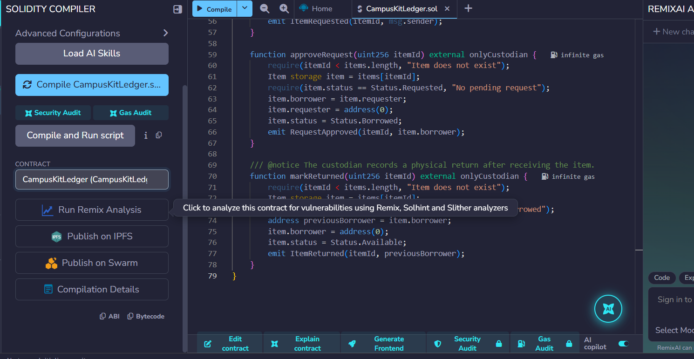
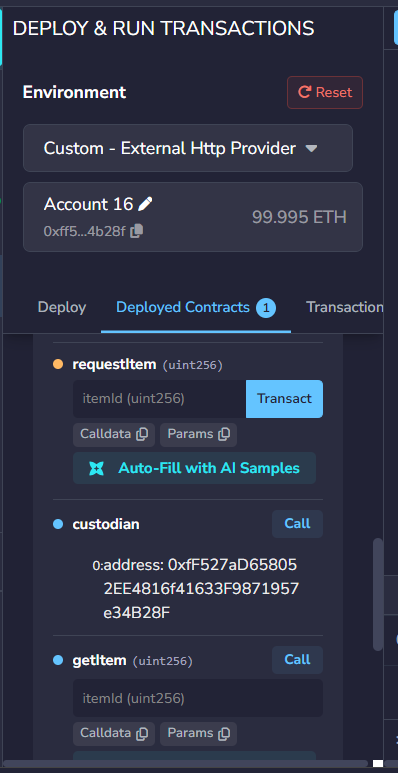
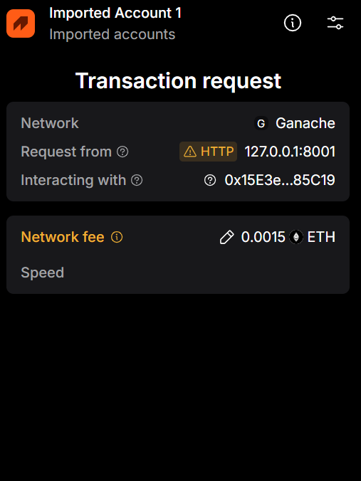
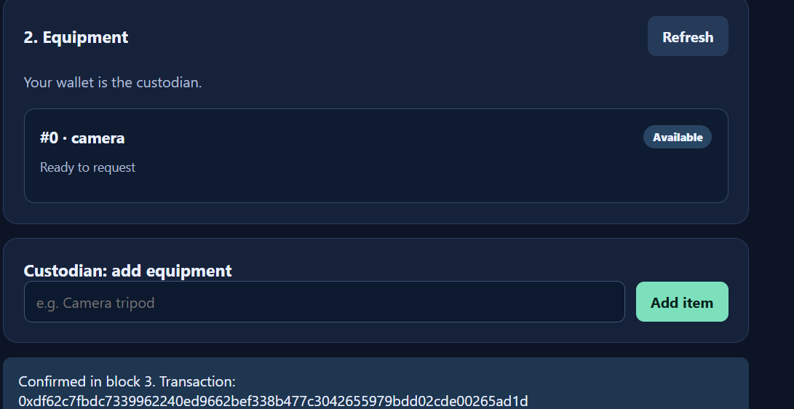
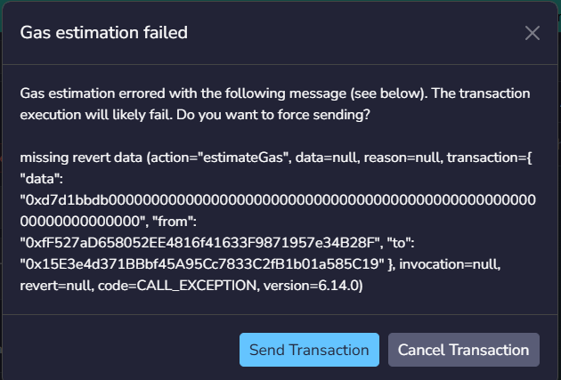
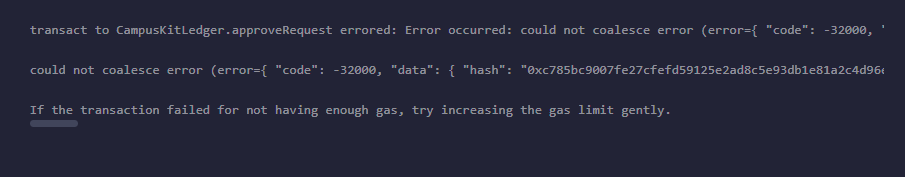
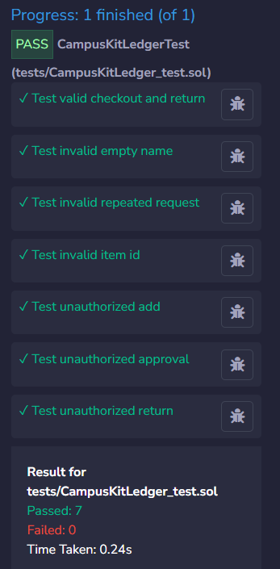

# Campus Kit Ledger

**Blockchain Technology (CSE4444) - Assignment 2**

## Problem and idea

A college lab often lends small items such as tripods, microphones, or adapters. A paper register can make it hard to see who requested an item and whether it is currently out. Campus Kit Ledger records the item's current state and wallet address on Ethereum. It deliberately has no payments, student names, or complex accounts.

The wallet that deploys the contract is the **custodian**. That wallet adds equipment, approves requests, and records a return after physically receiving the item. Any other wallet can request an available item. Everyone can read the current state.

`Available → Requested → Borrowed → Available`

Only one pending request per item is supported. A borrower is a wallet address, not verified proof of student identity. This is a classroom prototype; it does not prove that an actual handover occurred.

## Files

| File | Purpose |
| --- | --- |
| `contracts/CampusKitLedger.sol` | Solidity smart contract, state transitions, events and validation |
| `frontend/index.html`, `style.css`, `app.js` | Simple interface and MetaMask integration using Ethers.js |
| `tests/CampusKitLedger_test.sol` | Solidity unit tests for the Remix Unit Testing plugin |
| `tests/StudentWallet.sol` | Separate caller used by the authorization tests |
| `deployment.md` | Network, address, test observations and real transaction log |
| `evidence/` | Actual compilation, deployment, wallet, transaction and unit-test screenshots |

## Compile and deploy with Remix and Ganache

1. Run Ganache locally and note its **RPC URL** and **chain ID**. Keep the Ganache window running. Use only its disposable development accounts. Never put a private key in this repository.
2. In MetaMask, add the Ganache custom network using that RPC URL and chain ID, then import **one disposable Ganache account** into MetaMask. This account will be the custodian. Add a second disposable account for the student test.
3. Open [Remix IDE](https://remix.ethereum.org/). Make a workspace and copy the files in `contracts/` and `tests/` into the same paths. Choose Solidity compiler **0.8.20 or a compatible 0.8.x version**. In **Advanced Configurations**, set **EVM Version to London** for the archived Ganache UI, then compile `CampusKitLedger.sol`. A compiler default of Shanghai or later emits `PUSH0`, which this Ganache UI may not support. Save a screenshot of the successful compilation.
4. In Remix's **Deploy & Run Transactions** tab, select **Custom - External HTTP Provider** and enter the RPC URL shown in Ganache (usually `http://127.0.0.1:7545`). Choose the first Ganache account, also imported in MetaMask as the custodian. Select `CampusKitLedger`, turn off explorer verification for this local chain, and press **Deploy**. Copy the **deployed address**, **chain ID**, and deployment transaction hash into `deployment.md`. Save a deployment screenshot. This direct Ganache connection does not prompt MetaMask to sign the deployment; MetaMask signs the frontend interactions later.
5. For the frontend, open a terminal in `frontend/` and run `python -m http.server 8000`. Visit `http://localhost:8000` in a browser with MetaMask. Click **Connect MetaMask**, then **Switch to Ganache (chain 1337)** and approve if another network is active. Paste the deployed address and click **Load contract**. The frontend gets the state through Ethers.js and asks MetaMask to sign writes. A simple local HTTP server is needed because `app.js` is an ES module.
6. With the custodian account, add `Camera tripod`. Switch MetaMask to the student account and request item `#0`. Switch back to custodian, approve the request, then confirm a physical return. Refresh the interface between steps if needed. Record actual transaction hashes and screenshots in `deployment.md` and `evidence/`.

**Alternative:** Use an Ethereum test network in place of Ganache. Use test ETH only. Remix's in-browser VM is useful for quick checks but does **not** satisfy the assignment's Ganache-or-test-network deployment requirement.

## Run the unit tests

In Remix, copy both files in `tests/` to the same paths, enable the **Solidity Unit Testing** plugin, select `tests/CampusKitLedger_test.sol`, and run its tests. The file deploys a fresh contract before each test. `StudentWallet` makes calls from a separate address to check authorization. Save the displayed test results. The tests should be **run and their actual outcome recorded** in `deployment.md` before submission.

| Test | Input / caller | Expected result | Observed result |
| --- | --- | --- | --- |
| Valid flow | Student requests #0, custodian approves and marks returned | States Requested, Borrowed, Available | Passed in Remix |
| Invalid name | Custodian adds `""` | Revert: `Name must be 1-64 bytes` | Passed in Remix |
| Invalid repeat | Request item already Requested | Revert: `Item is not available` | Passed in Remix |
| Invalid ID | Request item #99 | Revert: `Item does not exist` | Passed in Remix |
| Unauthorized add | Student calls `addItem` | Revert: `Only custodian` | Passed in Remix |
| Unauthorized approval | Student calls `approveRequest` | Revert: `Only custodian` | Passed in Remix |
| Unauthorized return | Student calls `markReturned` | Revert: `Only custodian` | Passed in Remix |

For the failed-action evidence, `approveRequest(0)` was tried in Remix while item #0 was Available. Remix first showed a gas-estimation warning and then an error after **Send Transaction**; the actual screens are saved under `evidence/05-failed-estimate.png` and `06-failed-transaction.png`. Remix did not display the complete revert reason in the captured error. The unit test verifies the `No pending request` validation.

## Contract walkthrough

`constructor()` saves the deploying wallet as `custodian`. `addItem` checks the caller and name size. `requestItem` checks that the item exists and is Available. `approveRequest` is restricted to the custodian and moves a Requested item to Borrowed. `markReturned` is also restricted to the custodian, so a student cannot unilaterally claim to have returned physical equipment. `getItem` and `itemCount` are read-only calls; the frontend displays these values. Successful writes emit events and produce transaction hashes.

## Screenshots

These are captures from the actual Remix, Ganache, MetaMask, and browser session.

### Compilation and deployment

### MetaMask and successful transaction

### Failed approval attempt and tests

Item #0 was Available, so `approveRequest(0)` could not succeed. Remix first reported a failed gas estimate and then reported an error after the transaction was sent.

## Submission checklist

- [x] Compile in Remix and save real compilation screenshot.
- [x] Deploy via Ganache at `0x15E3e4d371BBbf45A95Cc7833C2fB1b01a585C19`; deployment transaction hash was not captured.
- [x] Run seven Remix unit tests; save the actual 7 passed, 0 failed screenshot.
- [x] Connect MetaMask on Ganache; add `camera` and capture the confirmed transaction and blockchain item in the UI.
- [x] Capture a failed approval attempt and the Remix error, with screenshots.
- [x] Push the project and actual evidence to this GitHub repository.
- [x] Repository is public, so the evaluator can access it.
- [x] Add the repository URL to the submission Word document and export to PDF.
- [ ] Upload the final PDF to LMS before the deadline.

Never commit private keys, seed phrases, passwords, account exports, or `.env` files.
